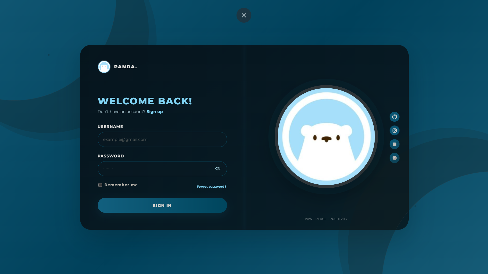

# ⚡ EBOLT

### Your space. Your ideas. Your experience.

<p align="center">
  A modern digital workspace with a distinctive dark interface, smooth interactions, and a clean visual identity.
</p>

<p align="center">
  <a href="https://241fa18462-tarun.github.io/Ebolt-website/">
    <strong>🌐 OPEN LIVE WEBSITE →</strong>
  </a>
</p>

---

## ✦ Website Preview

<p align="center">
  <a href="https://241fa18462-tarun.github.io/Ebolt-website/" title="Visit the live EBOLT website">
    
  </a>
</p>

<p align="center">
  <a href="https://241fa18462-tarun.github.io/Ebolt-website/">
    
  </a>
</p>

---

## ✨ About the Project

**EBOLT** is a web-based workspace built to combine useful productivity features with a polished, modern interface.

Designed around a deep navy background, cyan accents, and smooth visual effects, it aims to make everyday interactions feel simple and engaging.

## 🚀 Features

- **Modern UI** — Dark theme, cyan highlights, and elegant visual styling.
- **Notes Management** — Create, edit, organize, and delete notes.
- **Personal Profile** — View and manage supported profile information.
- **Account Interface** — Sign-in and registration screens.
- **Interactive Design** — Animated backgrounds and smooth transitions.
- **Browser Storage** — Save supported data locally in the browser.
- **Responsive Layout** — Designed for different screen sizes.

## 🧰 Built With

`HTML5` · `CSS3` · `JavaScript` · `GitHub Pages`

## 🌐 Live Demo

**Experience EBOLT here:**

### 👉 [Visit the EBOLT Website](https://241fa18462-tarun.github.io/Ebolt-website/)

## 💻 Run Locally

```bash
git clone https://github.com/241fa18462-Tarun/Ebolt-website.git
cd Ebolt-website
```

Open `index.html` in your browser.

## 👨‍💻 Creator

Created by **Tarun**, with a focus on modern web design, creativity, and interactive experiences.

---

<p align="center">
  <strong>⚡ EBOLT — A DIFFERENT KIND OF DIGITAL EXPERIENCE.</strong>
  <br/><br/>
  <a href="https://241fa18462-tarun.github.io/Ebolt-website/">VISIT WEBSITE ↗</a>
</p>
